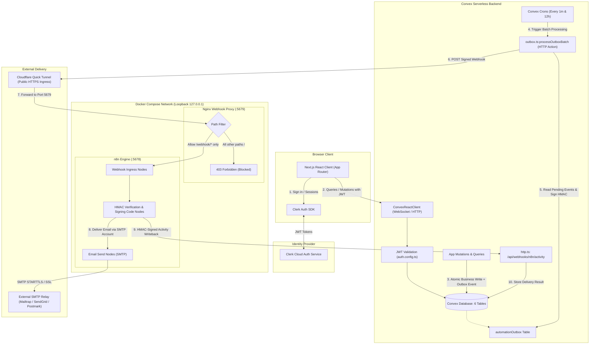

# LendLoop — Neighborhood Tool-Sharing Platform

LendLoop is a community-driven web application designed to facilitate peer-to-peer tool sharing among neighbors. It enables community members to list unused tools, browse neighborhood inventory, schedule and manage borrow requests, and track active loans. LendLoop incorporates server-enforced business rules, role-based access control, a transactional outbox architecture, and an automated notification pipeline powered by n8n and SMTP.

---

## 1. Project Overview

Modern households often own specialized tools (power drills, lawn aerators, carpet cleaners, camping gear) that are used infrequently. LendLoop provides a trusted digital commons for neighbors to borrow and lend these physical items responsibly.

### User Roles
- **Member / User (`role: "user"`):** Any authenticated neighbor. Members can publish tool listings, edit and deactivate their own tools, submit borrow requests for available tools, and manage incoming requests for tools they own.
- **Trusted Lender (`isTrustedLender: true`):** A platform designation granted by administrators to vetted, highly reliable community lenders to highlight dependable neighbors.
- **Administrator (`role: "admin"`):** Privileged operators who can view platform-wide lending metrics, review the user registry, toggle Trusted Lender badges, monitor all community loans, and moderate listings via soft deactivation and restoration.

### Lending Workflow
1. **Listing:** A tool owner creates a listing specifying category, condition, and description.
2. **Borrow Request:** A neighbor selects an available tool and submits a request with requested start and end dates (`[startDate, endDate)`). Pending requests are not confirmed reservations and may coexist for the same tool and dates. Submissions are rejected if they overlap an already existing active loan.
3. **Owner Decision:** The tool owner reviews incoming requests on their dashboard and chooses to **Approve** or **Decline**.
4. **Active Loan Creation:** Approving a request executes the final active-loan overlap check to ensure no conflicting loan was created in the interim. Upon passing, it transitions the request status to `"approved"` and atomically generates an active loan record (`status: "active"`) with a designated return due date.
5. **Return Confirmation:** Once the tool has been returned, either participant (the lender or the borrower) can mark the active loan as `"returned"` (`status: "returned"`), recording the return timestamp and freeing the tool for subsequent bookings.
6. **Automation & Notifications:** Key lifecycle events (`borrow_request.created`, `borrow_request.approved`, `borrow_request.declined`, `loan.returned`, `loan.overdue`) are atomically staged in a transactional outbox and dispatched to an n8n automation engine to notify participants via email.

---

## 2. Features

### Implemented Functionality
- **Authentication & User Identity:**
  - Secure signup and signin via Clerk.
  - Automatic synchronization of authenticated Clerk identities into Convex database user records via `users:storeUser`.
  - Client-side auth provider integration with custom brand theming (`ConvexProviderWithClerk`).
  - Next.js server-side route protection using Clerk middleware (`src/proxy.ts`).
- **Tool Management:**
  - Tool catalog browsing with real-time reactive queries.
  - Category filtering (`Power Tools`, `Garden`, `Kitchen`, `Camping`, `Cleaning`, `Other`).
  - Condition filtering (`New`, `Excellent`, `Good`, `Fair`).
  - Create, edit, and soft-deactivate owned tools.
  - Deactivated tools are hidden from catalog browsing while preserving historical loan records and relationship integrity.
- **Borrow Requests & Decisions:**
  - Date-bounded borrow request submission with ISO date validation (`YYYY-MM-DD`).
  - Half-open interval calendar conflict detection (`[startDate, endDate)`): pending requests are unconfirmed inquiries that may coexist, while the final active-loan conflict check is executed atomically during lender approval before creating the loan, preventing double-booking.
  - Borrower request dashboard (`/my-requests`) and lender incoming request dashboard (`/incoming-requests`).
  - Atomic approval/decline mutations with outbox event emission.
- **Loan Lifecycle:**
  - Active loan tracking with borrower and lender participant details (`/loans`).
  - Either the lender or the borrower can mark an active loan as returned via `loans:markReturned`, recording a server-generated return timestamp.
  - Overdue date boundary detection logic supporting both strict past due dates and same-day boundary conditions.
- **Administrative Operations (`/admin`):**
  - Platform-wide aggregate statistics (total users, active listings, active loans, returned loans).
  - Full user registry visibility with role and status indicators.
  - One-click elevation and revocation of Trusted Lender status.
  - Comprehensive platform loan registry visibility across all users.
  - Administrative tool moderation: soft deactivation and reactivation of any listing.
  - Protected by backend role enforcement (`requireAdmin`) and client-side access control.
- **Automation & Background Processing:**
  - Transactional outbox table (`automationOutbox`) ensuring zero dual-write inconsistencies.
  - Periodic background outbox batch processor scheduled via Convex crons (every 1 minute).
  - Background overdue scanner scheduled via Convex crons (every 12 hours) with daily event deduplication.
  - n8n integration across 4 event workflows with delivery failure branching, exponential backoff retries, claim ownership locking, and HMAC-SHA256 signature verification.
  - Loopback-bound Nginx reverse proxy restricting public webhook ingress to `/webhook/*` only.

### Planned / Future Functionality (Not Yet Implemented)
- In-app direct messaging between lenders and borrowers.
- Geolocation and radius-based neighborhood proximity search.
- User review and star-rating system following completed loans.
- Photo and media upload integration (currently uses placeholder and categorized imagery).
- Security deposit or damage insurance tracking.

---

## 3. Technology Stack

Verified technology components and versions:

| Component | Technology | Version | Purpose |
| :--- | :--- | :--- | :--- |
| **Framework** | [Next.js](https://nextjs.org/) | `16.4.5` (App Router) | React framework, SSR, client routing, middleware proxy |
| **UI Library** | [React](https://react.dev/) | `19.3.0` | Declarative user interface components |
| **Styling** | [Tailwind CSS](https://tailwindcss.com/) | `^4.0.0` (Turbopack) | Modern utility-first styling |
| **Animation** | [Motion](https://motion.dev/) | `^14.9.1` | Framer Motion animations and page transitions |
| **Icons** | [Lucide React](https://lucide.dev/) | `^1.68.0` | Consistent iconography across navigation and actions |
| **Language** | [TypeScript](https://www.typescriptlang.org/) | `^5.0.0` | Static type checking and interface contracts |
| **Authentication** | [Clerk](https://clerk.com/) | `@clerk/nextjs ^6.39.8` | Session management, sign-in/up UI, JWT issuance |
| **Database & Backend** | [Convex](https://www.convex.dev/) | `^1.49.0` | Reactive serverless database, queries, mutations, crons |
| **Automation Engine** | [n8n](https://n8n.io/) | `docker.n8n.io/n8nio/n8n:latest` | Workflow automation orchestrator and webhook consumer |
| **Ingress Proxy** | [Nginx](https://nginx.org/) | `nginx:alpine` | Webhook-only reverse proxy enforcing path isolation |
| **Container Runtime** | [Docker Compose](https://docs.docker.com/compose/) | Compose v2 | Local container orchestration for n8n and Nginx proxy |
| **Testing** | Node.js Test Runner / tsx | Node `>= 20.9.0`, `tsx ^4.23.15` | Native unit, security, regression, and sandbox tests |

---

## 4. Architecture

LendLoop separates concerns across the user-facing application, transactional database, serverless background workers, and automation engines.



### Communication & Data Responsibilities
1. **Next.js & Convex:** The React frontend connects directly to Convex via WebSocket for real-time reactivity. All database mutations (tool creation, requests, loan returns) execute within ACID transactions.
2. **Transactional Outbox:** Business mutations never make external network calls directly. Instead, an event is atomically inserted into `automationOutbox` in the same transaction. If an external service is unavailable, the business operation still succeeds safely.
3. **Event Dispatch:** A Convex cron worker periodically claims pending outbox events using a unique claim token and timestamp, signs the payload with HMAC-SHA256, and dispatches it over HTTPS to the n8n webhook URL.
4. **Nginx Webhook Isolation:** External webhooks enter through an Nginx proxy on port 5679. The proxy forwards requests matching `/webhook/*` to n8n while returning `403 Forbidden` for all other paths (including `/`, the n8n editor, and REST APIs).
5. **n8n Verification & SMTP:** n8n Code nodes verify the HMAC signature and timestamp freshness ($\le 5\text{ minutes}$ tolerance). The workflow formats email messages and invokes the `emailSend` node using credentials stored in n8n's encrypted vault.
6. **Activity Writeback:** Upon delivery attempt (success or failure), n8n calculates an HMAC-SHA256 signature and POSTs an activity report back to Convex at `/api/webhooks/n8n/activity`, ensuring delivery status is audited in `automationActivity`.

---

## 5. Project Structure

```
LendLoop/
├── .env.example                               # Canonical template for all environment configurations
├── docker-compose.yml                         # Container configuration for n8n and Nginx proxy
├── package.json                               # Dependencies, engines, and test scripts
├── tsconfig.json                              # TypeScript configuration
├── AGENTS.md                                  # Workspace development guidelines
├── README.md                                  # Root documentation
├── convex/                                    # Convex backend serverless functions & schema
│   ├── _generated/                            # Autogenerated Convex client bindings & data models
│   ├── admin.ts                               # Admin platform metrics, loan visibility & tool moderation
│   ├── auth.config.ts                         # Clerk JWT provider domain configuration
│   ├── authHelpers.ts                         # User authentication and admin authorization helpers
│   ├── borrowRequests.ts                      # Borrow request lifecycle mutations and conflict detection
│   ├── crons.ts                               # Scheduled outbox processor and overdue scanner jobs
│   ├── dateUtils.ts                           # ISO date boundary, interval overlap, and overdue logic
│   ├── http.ts                                # Convex HTTP endpoints (n8n activity callback webhook)
│   ├── loans.ts                               # Loan return confirmation and active loan queries
│   ├── outbox.ts                              # Outbox batch dispatcher, claim lock, and overdue queue
│   ├── schema.ts                              # 6-table database schema with controlled validators
│   ├── tools.ts                               # Tool listing CRUD, filtering, and soft deactivation
│   ├── users.ts                               # User provisioning and internal admin bootstrap mutation
│   └── webhookSecurity.ts                     # HMAC-SHA256 signing and verification utility functions
├── docs/
│   └── automation.md                          # Comprehensive Phase 7 automation and n8n architecture guide
├── n8n/
│   ├── proxy/
│   │   └── nginx.conf                         # Webhook-only reverse proxy configuration (port 5679)
│   └── workflows/
│       ├── workflow_a_request_created.json    # Workflow A: New borrow request notification to lender
│       ├── workflow_b_request_decision.json   # Workflow B: Approval/decline notification to borrower
│       ├── workflow_c_loan_returned.json      # Workflow C: Return confirmation notification to borrower
│       └── workflow_d_overdue_reminder.json   # Workflow D: Overdue loan reminder to borrower
├── src/
│   ├── app/                                   # Next.js App Router pages and layouts
│   │   ├── (authenticated)/                   # Authenticated route group (protected by proxy.ts)
│   │   │   ├── admin/page.tsx                 # Administrative console
│   │   │   ├── dashboard/page.tsx             # Member dashboard
│   │   │   ├── incoming-requests/page.tsx     # Lender request management
│   │   │   ├── listings/page.tsx              # Tool catalog browsing and creation
│   │   │   ├── loans/page.tsx                 # Active and returned loans
│   │   │   ├── my-requests/page.tsx           # Borrower request tracking
│   │   │   └── requests/page.tsx              # Requests overview redirect
│   │   ├── layout.tsx                         # Root HTML layout with Geist font & styling
│   │   ├── page.tsx                           # Public landing page
│   │   ├── sign-in/[[...sign-in]]/page.tsx    # Clerk sign-in route
│   │   └── sign-up/[[...sign-up]]/page.tsx    # Clerk sign-up route
│   ├── components/                            # Modular React UI components
│   │   ├── auth/                              # Authentication background components
│   │   ├── hero/                              # Landing page hero section
│   │   ├── layout/                            # Navbar, footer, and navigation
│   │   ├── sections/                          # "How it Works" & community sections
│   │   ├── tools/                             # Dialogs, cards, filters, and grids for tools
│   │   └── ui/                                # Primitives (button, dialog, badge, input, toast)
│   ├── features/tools/                        # Tool feature types and category constants
│   ├── lib/                                   # Client utility helpers (clsx/tailwind-merge)
│   ├── providers/                             # Convex and Clerk client-side context providers
│   └── proxy.ts                               # Next.js middleware enforcing Clerk session protection
└── tests/                                     # Automated test suites
    ├── admin.test.ts                          # Admin operations & authorization security suite (22 tests)
    ├── automation.test.ts                     # Phase 7 automation, HMAC, outbox & sandbox suite (30 tests)
    └── overdue.test.mjs                       # Date boundary and half-open interval unit suite (6 tests)
```

---

## 6. Prerequisites

Ensure your development environment meets these requirements:

- **Node.js:** `>= 20.9.0` (official Next.js 16.4.5 engine requirement; verified and validated under Node.js `v24.21.0`)
- **Package Manager:** `npm` (v10+ bundled with Node)
- **Docker Desktop:** Installed and running (supports Docker Compose v2)
- **Clerk Account:** Free development account at [clerk.com](https://clerk.com) for authentication
- **Convex Account:** Free cloud project at [convex.dev](https://convex.dev)
- **SMTP Provider Credentials:** Mailtrap, SendGrid, Mailgun, Postmark, or local Mailpit for notification delivery
- **Cloudflare `cloudflared` CLI (Optional for webhooks):** Required for exposing the local Nginx proxy to Convex Cloud during development via a Quick Tunnel

---

## 7. Local Setup

LendLoop utilizes distinct runtime configuration contexts. Variables must be placed into their respective configuration locations as documented in [`.env.example`](.env.example).

### Step 1: Clone and Install Dependencies
```bash
git clone https://github.com/teja0604/LendLoop.git
cd LendLoop
npm install
```

### Step 2: Configure Next.js Environment (`.env.local`)
Create a `.env.local` file in the project root for the Next.js frontend:
```bash
cp .env.example .env.local
```
Edit `.env.local` to populate the following variables:
- `NEXT_PUBLIC_CONVEX_URL`: Your Convex Cloud deployment URL (e.g. `https://<deployment>.convex.cloud`).
- `CONVEX_DEPLOYMENT`: Your Convex project deployment ID (e.g. `dev:<deployment-name>`).
- `NEXT_PUBLIC_CLERK_PUBLISHABLE_KEY`: Clerk frontend key (`pk_test_...`).
- `CLERK_SECRET_KEY`: Clerk backend secret key (`sk_test_...`).
- `NEXT_PUBLIC_CLERK_SIGN_IN_URL`: `/sign-in`
- `NEXT_PUBLIC_CLERK_SIGN_UP_URL`: `/sign-up`
- `NEXT_PUBLIC_CLERK_SIGN_IN_FALLBACK_REDIRECT_URL`: `/dashboard`
- `NEXT_PUBLIC_CLERK_SIGN_UP_FALLBACK_REDIRECT_URL`: `/dashboard`

### Step 3: Configure Docker Compose Environment (`.env`)
Create a separate `.env` file in the project root consumed exclusively by `docker compose`:
```env
# 32-byte hexadecimal shared secret (generate with: node -e "console.log(require('crypto').randomBytes(32).toString('hex'))")
N8N_WEBHOOK_HMAC_SECRET=your_32_byte_hex_hmac_secret_here

# Base URL where Convex HTTP endpoints are hosted
CONVEX_SITE_URL=https://<your-deployment-name>.convex.site

# Outgoing notification From: email configuration
SMTP_SENDER_EMAIL=notifications@yourdomain.com
SMTP_USER=notifications@yourdomain.com
```

### Step 4: Start the n8n Engine and Nginx Proxy
```bash
docker compose up -d
```
Verify both containers are running and healthy:
```bash
docker compose ps
```
- n8n Editor UI: Bound to loopback at `http://127.0.0.1:5678`
- Nginx Webhook Proxy: Bound to loopback at `http://127.0.0.1:5679`

### Step 5: Start the Convex Backend Dev Process
In a separate terminal, launch Convex development:
```bash
npx convex dev
```

### Step 6: Start the Next.js Development Server
In another terminal, start the Next.js application:
```bash
npm run dev
```
Open [http://localhost:3000](http://localhost:3000) in your browser.

---

## 8. Convex Setup & Administrator Bootstrap

### Convex Cloud Dashboard Environment Variables
Convex functions execute in the Convex serverless cloud. Local `.env` or `.env.local` files are not read by Convex cloud functions at runtime. Configure these variables in the **Convex Dashboard** under **Project Settings → Environment Variables** (or via the Convex CLI):

```bash
# 1. Ingress webhook URL pointing to your tunnel or public webhook endpoint
npx convex env set N8N_WEBHOOK_URL "https://<your-tunnel-domain>.trycloudflare.com/webhook"

# 2. Shared HMAC secret (must match N8N_WEBHOOK_HMAC_SECRET in root .env)
npx convex env set N8N_WEBHOOK_HMAC_SECRET "your_32_byte_hex_hmac_secret_here"

# 3. Clerk JWT Issuer Domain (from Clerk Dashboard -> API Keys -> Frontend API)
npx convex env set CLERK_JWT_ISSUER_DOMAIN "https://<your-clerk-frontend-api>.clerk.accounts.dev"
```

### Secure Initial Administrator Bootstrap
LendLoop does **not** expose a public endpoint or automatic environment variable for administrative promotion. To elevate your first administrator:

1. Open the application at [http://localhost:3000](http://localhost:3000) and sign in once with Clerk. This executes `users:storeUser` and provisions your user record with `role: "user"`.
2. Locate your Clerk User ID (found in the Clerk Dashboard under **Users**, e.g., `user_2t...`).
3. Execute the internal bootstrap mutation using the Convex CLI from your terminal:
   ```bash
   npx convex run users:bootstrapAdmin '{"clerkUserId": "user_replace_with_your_clerk_id"}'
   ```
4. **Security Enforcement:**
   - If no administrator exists in the database, `bootstrapAdmin` elevates the specified user to `"admin"`.
   - If an administrator already exists, subsequent calls strictly enforce `requireAdmin(ctx)`, rejecting any non-admin caller.
5. Refresh the web application. The **Admin** link will now appear in your navigation bar, granting access to `/admin`.

---

## 9. n8n Automation Engine Setup

LendLoop integrates four implemented n8n workflows located in `n8n/workflows/`:
1. **Workflow A (`workflow_a_request_created.json`):** Triggers on `borrow_request.created`. Sends notification to the tool owner detailing the tool, borrower name, and requested dates.
2. **Workflow B (`workflow_b_request_decision.json`):** Triggers on `borrow_request.approved` or `borrow_request.declined`. Sends decision notices to the borrower.
3. **Workflow C (`workflow_c_loan_returned.json`):** Triggers on `loan.returned`. Sends a return confirmation notice to the borrower.
4. **Workflow D (`workflow_d_overdue_reminder.json`):** Triggers on `loan.overdue`. Sends an urgent return reminder to the borrower with loan due date and owner contact information.

### Step 1: Open n8n and Create the SMTP Credential
1. Open [http://127.0.0.1:5678](http://127.0.0.1:5678) in your browser and complete the initial account setup.
2. Navigate to **Credentials → Add Credential → SMTP**.
3. Fill in the connection settings:
   - **Credential Name:** `LendLoop SMTP Account`
   - **Host:** Your SMTP host (e.g., `smtp.mailtrap.io`, `smtp.sendgrid.net`, `smtp.postmarkapp.com`, or local `mailpit`)
   - **Port:** `587` (STARTTLS) or `465` (SSL/TLS)
   - **User:** Your SMTP username / API key
   - **Password:** Your SMTP password / secret
   - **SSL/TLS:** Enable according to your provider requirements
4. Save and test the credential.

> [!NOTE]
> Setting SMTP credentials in `.env` does not configure n8n credentials. The `emailSend` nodes specifically reference the internal credential named `LendLoop SMTP Account` (`id: lendloop-smtp-credential`).

### Step 2: Import and Bind Workflows
1. In n8n, navigate to **Workflows → Import from File**.
2. Import the four files from `n8n/workflows/`:
   - `workflow_a_request_created.json`
   - `workflow_b_request_decision.json`
   - `workflow_c_loan_returned.json`
   - `workflow_d_overdue_reminder.json`
3. In each workflow canvas, verify the **Send Email** node has the `LendLoop SMTP Account` credential selected.
4. Toggle each workflow switch to **Active**.

### Step 3: Establish Public Webhook Ingress (Cloudflare Tunnel)
Convex executes in the cloud and requires a publicly accessible HTTPS endpoint to reach your local n8n instance:
1. Start a Cloudflare Quick Tunnel pointing to the **Nginx Proxy** (port 5679):
   ```bash
   cloudflared tunnel --url http://localhost:5679
   ```
2. Note the generated HTTPS URL (e.g., `https://random-words.trycloudflare.com`).
3. Set this URL in your Convex Dashboard environment:
   ```bash
   npx convex env set N8N_WEBHOOK_URL "https://random-words.trycloudflare.com/webhook"
   ```
4. **Important:** Keep the `cloudflared` tunnel process running in its terminal during local development.

---

## 10. Testing & Validation

LendLoop includes a comprehensive suite of unit, security, outbox, and sandbox execution tests.

### Running Tests
Execute the full test suite with:
```bash
npm test
```

Execute code linting:
```bash
npm run lint
```

Execute a production build verification:
```bash
npm run build
```

### Test Suite Structure and Assertion Breakdown
`npm test` executes three test runners in sequence:

1. **Date Boundary & Interval Unit Suite (`tests/overdue.test.mjs`):**
   - **6 individually reported checks** verifying overdue evaluation against past dates, same-day boundary behavior, future dates, returned loan exclusion, and half-open interval collision logic.
2. **Admin Operations & Authorization Suite (`tests/admin.test.ts`):**
   - **22 individually reported checks** validating first-time bootstrap authorization, elevation rejection for unauthenticated users and ordinary members, Trusted Lender toggling, platform-wide loan visibility, soft deactivation, and restoration.
   - *Note on Terminal Output:* The printed summary banner at the end of `admin.test.ts` displays a legacy string stating `"All 18 Real Convex Function Security & Regression Tests Passed!"`, reflecting an earlier milestone before Sections 2, 4, and 5 were expanded to 22 individual tests.
3. **Comprehensive Automation, Outbox & Security Suite (`tests/automation.test.ts`):**
   - **30 individually reported checks** executed inside one top-level Node.js test-runner wrapper (`node:test`).
   - Validates atomic outbox emission, claim ownership token locking, delivery failure branching (`onError: "continueErrorOutput"`), HTTP 500 recovery, malformed response handling, HMAC-SHA256 signature verification, replay protection (5-minute window), daily deduplication of overdue scans, Docker Compose loopback binding, and isolated sandbox execution of n8n Code node scripts.

Total: **58 distinct runtime test checks** executed and verified across the codebase.

---

## 11. Security Architecture & Considerations

- **Server-Side Authorization in Convex:**
  - Client-side checks are treated purely as UI conveniences. Protected operations enforce authentication and authorization server-side (`requireAuthenticatedUser`, `requireOwnerOrAdmin`, `requireAdmin`), ensuring callers cannot access or modify unauthorized records.
  - Intentionally public queries (such as `tools:getPublicAvailableTools` for anonymous tool catalog browsing) remain accessible without authentication, enforcing strict privacy-preserving projections (only active tool names and categories are returned, never owner identities, descriptions, or loan history).
  - Users cannot alter their own `role`, `clerkUserId`, or `isTrustedLender` status.
- **HMAC-SHA256 Webhook Security:**
  - All webhook payloads dispatched by Convex are signed with `X-LendLoop-Signature` (`sha256=<hex>`) and include `X-LendLoop-Timestamp`.
  - n8n Code nodes verify signatures using `crypto.timingSafeEqual` and enforce a 5-minute freshness tolerance ($|t_{\text{server}} - t_{\text{header}}| \le 300,000\text{ ms}$) to defeat replay attacks.
  - Activity writeback reports sent back to Convex are similarly signed and verified by `convex/http.ts`.
- **Transactional Outbox & Idempotency:**
  - Events are emitted atomically within the business transaction. Outbox processing uses claim tokens and timeout-based stale lock recovery to eliminate duplicate dispatch.
  - Activity writebacks use unique idempotency keys (`notif:req_created:<id>`, `overdue:<loanId>:<date>`). Duplicate callbacks are safely deduplicated without overwriting confirmed success records.
- **Soft Deactivation:**
  - Member and administrator tool deletions are soft (`isActive: false`). Active loans, past history, and referential integrity are never broken or cascade-deleted.
- **Local Network Isolation:**
  - `docker-compose.yml` binds the n8n editor (`5678`) and Nginx proxy (`5679`) strictly to `127.0.0.1`.
  - The Nginx proxy blocks direct access to `/` and forwards only `/webhook/*` paths.
- **n8n Environment Access & Container Secrets:**
  - `N8N_BLOCK_ENV_ACCESS_IN_NODE=false` is set in `docker-compose.yml` to allow workflow Code nodes to access container environment variables (`$env.N8N_WEBHOOK_HMAC_SECRET`, `$env.CONVEX_SITE_URL`, `$env.SMTP_USER`, `$env.SMTP_SENDER_EMAIL`) necessary for HMAC verification, writeback signing, and sender address resolution.
  - *Security Implication:* Disabling environment access blocking allows any Code node executed within the n8n container to read these secrets. This potentially exposes HMAC and SMTP credentials to anyone with permissions to edit or execute untrusted workflows in the n8n instance.
  - Binding the n8n editor port strictly to loopback (`127.0.0.1:5678`) eliminates direct remote network exposure of the editor, but it does not eliminate the risk for local workflow authors or anyone with access to the editor console. In production, access to the n8n editor must be strictly authenticated and restricted.
- **Secret Protection:**
  - Root `.env`, `.env.local`, and n8n vault credentials must never be committed to source control. Canonical templates and variables are maintained in [`.env.example`](.env.example).

---

## 12. Known Limitations & Production Readiness

LendLoop is an active engineering project and is **not yet certified for production deployment**. The following areas require operational hardening prior to public hosting:

1. **Ingress Architecture:** Cloudflare Quick Tunnels (`trycloudflare.com`) are ephemeral and intended only for local development. Production deployments require a permanent domain, managed SSL certificates, and a dedicated ingress or persistent Cloudflare Named Tunnel.
2. **Production Clerk & Convex Setup:** Transitioning from development instances to production requires configuring custom domains, production Clerk API keys (`pk_live_...`, `sk_live_...`), and verifying the production Clerk JWT issuer in Convex Dashboard (`CLERK_JWT_ISSUER_DOMAIN`).
3. **SMTP Deliverability & Monitoring:** Development SMTP relays (such as Mailtrap) do not deliver to real inboxes. Production requires a verified sending domain with SPF, DKIM, and DMARC records on providers such as SendGrid, Postmark, or AWS SES.
4. **n8n State & Vault Persistence:** The local n8n setup uses a Docker named volume (`n8n_data`). Production hosting requires an external PostgreSQL database for n8n execution history and automated backup/restore routines for the n8n encryption key.
5. **Live Verification of Declined Request Notice:** While Workflow B logic and sandbox execution tests cover both approved and declined states, live end-to-end receipt of declined notice emails with an external inbox remains to be verified.
6. **Scheduled Overdue End-to-End Verification:** The 12-hour cron job (`scanOverdueLoansAndQueueOutbox`) and Workflow D have been tested in simulated environments; full live testing using a genuinely overdue active loan across date boundaries requires operational confirmation.
7. **Absence of Browser E2E Tests:** LendLoop currently lacks automated browser-level E2E tests (such as Playwright or Cypress). While Convex functions, unit logic, and n8n Code scripts are thoroughly tested, automated UI interaction testing is not yet established.

---

## 13. Documentation Links

- [Phase 7 Automation & Architecture Guide](docs/automation.md) (`docs/automation.md`): Detailed technical specifications for transactional outbox dispatch, n8n webhook error branching, delivery acknowledgement semantics, and HMAC cryptographic signing.
- [Canonical Environment Template](.env.example) (`.env.example`): Reference inventory of all verified environment variables, runtime locations, and setup notes.
