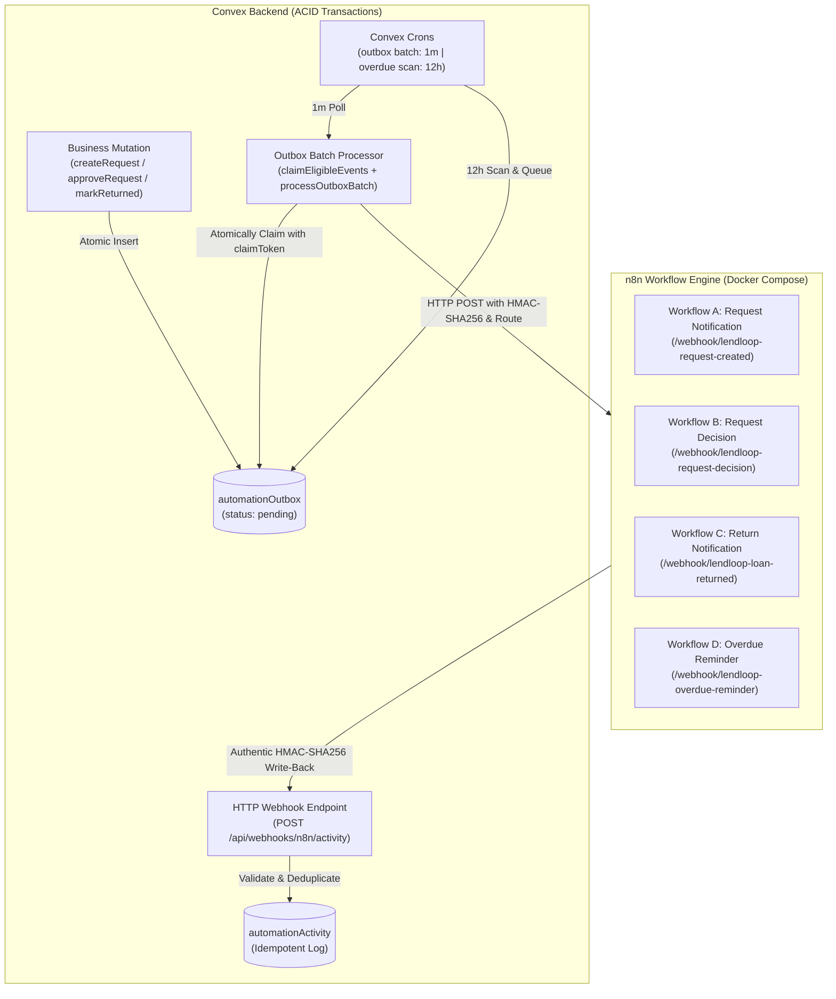

# LendLoop — Phase 7: n8n Automation and Webhook Integration

This document provides a comprehensive technical overview and operational guide for the LendLoop automation and webhook integration architecture.

---

## 1. Architecture Overview

LendLoop implements a reliable event-driven automation layer using the **Transactional Outbox Pattern** alongside **n8n workflow orchestration** and **HMAC-SHA256 authenticated webhooks**.



### Core Reliability Guarantees
1. **Zero Dual-Write Risk**: Events are never dispatched directly to external HTTP webhooks inside user-facing mutations. Events are atomically inserted into `automationOutbox` within the exact same database transaction as the business state transition.
2. **True Delivery Verification (No False Success)**: `processOutboxBatch` requires active `N8N_WEBHOOK_URL` and `N8N_WEBHOOK_HMAC_SECRET` configuration. If missing or unreachable, events are recorded as failures and retried. A success status is never simulated.
3. **Claim Tokens & Ownership Protection**: Stale claims are recovered based on `processingStartedAt` (not creation time). Claim mutations assign a unique `claimToken` to prevent slow or expired workers from overwriting results from newer workers.
4. **Authentic End-to-End HMAC-SHA256 Security**: Both inbound event dispatches and outbound activity callbacks are signed using `${timestamp}.${rawBody}` and checked in constant time with a 5-minute timestamp tolerance.
5. **Idempotent Retry Updating**: When a previously failed notification succeeds on a subsequent worker retry, the existing `automationActivity` record is updated from `"failed"` to `"sent"`, preserving accurate final outcomes without duplicates.

---

## 2. Webhook Routing & Event Catalog

The outbox processor resolves the destination webhook URL dynamically based on the event type using `resolveWebhookUrl`:

| Event Type | Destination Path | Triggering Domain Operation |
| :--- | :--- | :--- |
| `borrow_request.created` | `/webhook/lendloop-request-created` | Neighbor creates a new borrow request |
| `borrow_request.approved` | `/webhook/lendloop-request-decision` | Tool owner approves request |
| `borrow_request.declined` | `/webhook/lendloop-request-decision` | Tool owner declines request |
| `loan.created` | `/webhook/lendloop-loan-created` | Handled alongside approval for loan activation tracking |
| `loan.returned` | `/webhook/lendloop-loan-returned` | Tool marked returned by lender |
| `loan.overdue` | `/webhook/lendloop-overdue-reminder` | Convex cron scanner identifies overdue active loan |

Unsupported event types are explicitly rejected and marked as terminal failures with descriptive routing errors.

---

## 3. Webhook Security Specification (HMAC-SHA256)

Both Convex-to-n8n and n8n-to-Convex communications are signed and verified in constant time.

### Request Headers
| Header | Description | Example |
| :--- | :--- | :--- |
| `Content-Type` | Payload format | `application/json` |
| `X-LendLoop-Signature` | Hex-encoded HMAC-SHA256 signature | `sha256=a8f5c7...` |
| `X-LendLoop-Timestamp` | Unix timestamp in milliseconds | `1730995200000` |
| `X-LendLoop-Event` | Event type identifier | `borrow_request.created` |

### Signature Calculation & Verification
1. Signed content format: `${timestamp}.${rawBody}`.
2. In Convex: Computed using standard Web Crypto (`crypto.subtle`).
3. In n8n: Verified and generated in Code nodes using Node.js `crypto.createHmac("sha256", secret)` with `crypto.timingSafeEqual`.
4. Freshness check: Requests where $|t_{\text{server}} - t_{\text{header}}| > 300,000\text{ ms}$ (5 minutes) are rejected to eliminate replay attacks.

---

## 4. Notification Provider Integration (n8n SMTP)

Every n8n workflow executes a real notification provider step:
- **Provider Node**: `n8n-nodes-base.emailSend` (SMTP).
- **Environment Configuration**:
  - `SMTP_HOST`: Hostname of SMTP relay (e.g. `smtp.mailgun.org`, `smtp.sendgrid.net`, or local Mailpit/Mailtrap).
  - `SMTP_PORT`: SMTP port (e.g. `587` or `465`).
  - `SMTP_USER`: SMTP username.
  - `SMTP_PASSWORD`: SMTP secret/password.
  - `SMTP_SENDER_EMAIL`: From address (e.g. `notifications@lendloop.org`).
- **Recipient Address Validation**:
  - Workflows evaluate whether the recipient has a valid configured email address.
  - If recipient email is missing, the workflow branches directly to the failure write-back node with summary: `Notification skipped: Recipient email address not configured.`
  - If SMTP delivery fails, the failure write-back node logs: `SMTP provider delivery failed.`
  - A `"sent"` status is recorded **only** after the provider confirms delivery.

---

## 5. Overdue Reminder Processing

- **Authoritative Scheduler**: Convex cron job (`scan-overdue-loans` in `convex/crons.ts`, running every 12 hours).
- **Deterministic Outbox Identity**: Event ID formatted as `overdue_<loanId>_<YYYY-MM-DD>`.
- **Daily Deduplication**:
  - If an overdue reminder was already queued or recorded for a loan on the current UTC calendar day, subsequent scans skip queueing.
  - Guarantees borrowers receive at most one reminder per overdue loan per UTC day.
- **Outbox Dispatch**: Events pass through the standard outbox processor, dispatching to `/webhook/lendloop-overdue-reminder`.

---

## 6. Importing and Activating Workflows in n8n

To deploy the workflows in n8n:

1. Launch n8n:
   ```bash
   docker compose up -d
   ```
2. Open the n8n console at `http://localhost:5678`.
3. In n8n, click **Workflows** → **Import from File...** and import each JSON file from `n8n/workflows/`:
   - `workflow_a_request_created.json`
   - `workflow_b_request_decision.json`
   - `workflow_c_loan_returned.json`
   - `workflow_d_overdue_reminder.json`
4. Toggle each workflow to **Active** (green).

---

## 7. Environment Variables Reference

| Variable | Environment | Description |
| :--- | :--- | :--- |
| `N8N_WEBHOOK_URL` | Convex | Base URL for n8n webhooks (e.g. `http://localhost:5678/webhook`) |
| `N8N_WEBHOOK_HMAC_SECRET` | Convex & n8n | Shared 32+ byte cryptographic secret for HMAC-SHA256 signing |
| `CONVEX_SITE_URL` | n8n | Convex HTTP action URL (e.g. `https://<deployment>.convex.site` or `http://localhost:3000`) |
| `NODE_FUNCTION_ALLOW_BUILTIN` | n8n | Must be set to `crypto` so n8n Code nodes can verify and sign HMACs |
| `SMTP_HOST` | n8n | SMTP server host |
| `SMTP_PORT` | n8n | SMTP port (default `587`) |
| `SMTP_USER` | n8n | SMTP authentication username |
| `SMTP_PASSWORD` | n8n | SMTP authentication password |
| `SMTP_SENDER_EMAIL` | n8n | Verified sender address |
