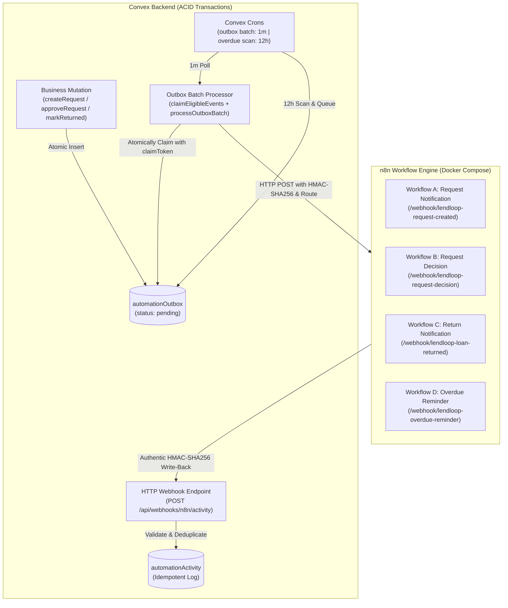

# LendLoop — Phase 7: n8n Automation and Webhook Integration

This document provides a comprehensive technical overview and operational guide for the LendLoop automation and webhook integration architecture.

---

## 1. Architecture Overview

LendLoop implements a reliable event-driven automation layer using the **Transactional Outbox Pattern** alongside **n8n workflow orchestration** and **HMAC-SHA256 authenticated webhooks**.



### Core Reliability Guarantees
1. **Zero Dual-Write Risk**: Events are never dispatched directly to external HTTP webhooks inside user-facing mutations. Events are atomically inserted into `automationOutbox` within the exact same database transaction as the business state transition.
2. **True Delivery Verification (No False Success)**: `processOutboxBatch` requires active `N8N_WEBHOOK_URL` and `N8N_WEBHOOK_HMAC_SECRET` configuration. If missing or unreachable, events are recorded as failures and retried. A success status is never simulated.
3. **Claim Tokens & Ownership Protection**: Stale claims are recovered based on `processingStartedAt` (not creation time). Claim mutations assign a unique `claimToken` to prevent slow or expired workers from overwriting results from newer workers.
4. **Authentic End-to-End HMAC-SHA256 Security**: Both inbound event dispatches and outbound activity callbacks are signed using `${timestamp}.${rawBody}` and checked in constant time with a 5-minute timestamp tolerance.
5. **Idempotent Retry Updating**: When a previously failed notification succeeds on a subsequent worker retry, the existing `automationActivity` record is updated from `"failed"` to `"sent"`, preserving accurate final outcomes without duplicates.

---

## 2. Webhook Routing & Event Catalog

The outbox processor resolves the destination webhook URL dynamically based on the event type using `resolveWebhookUrl`:

| Event Type | Destination Path | Triggering Domain Operation |
| :--- | :--- | :--- |
| `borrow_request.created` | `/webhook/lendloop-request-created` | Neighbor creates a new borrow request |
| `borrow_request.approved` | `/webhook/lendloop-request-decision` | Tool owner approves request |
| `borrow_request.declined` | `/webhook/lendloop-request-decision` | Tool owner declines request |
| `loan.created` | `/webhook/lendloop-loan-created` | Handled alongside approval for loan activation tracking |
| `loan.returned` | `/webhook/lendloop-loan-returned` | Tool marked returned by lender |
| `loan.overdue` | `/webhook/lendloop-overdue-reminder` | Convex cron scanner identifies overdue active loan |

Unsupported event types are explicitly rejected and marked as terminal failures with descriptive routing errors.

---

## 3. Webhook Security Specification (HMAC-SHA256)

Both Convex-to-n8n and n8n-to-Convex communications are signed and verified in constant time.

### Request Headers
| Header | Description | Example |
| :--- | :--- | :--- |
| `Content-Type` | Payload format | `application/json` |
| `X-LendLoop-Signature` | Hex-encoded HMAC-SHA256 signature | `sha256=a8f5c7...` |
| `X-LendLoop-Timestamp` | Unix timestamp in milliseconds | `1730995200000` |
| `X-LendLoop-Event` | Event type identifier | `borrow_request.created` |

### Signature Calculation & Verification
1. Signed content format: `${timestamp}.${rawBody}`.
2. In Convex: Computed using standard Web Crypto (`crypto.subtle`).
3. In n8n: Verified and generated in Code nodes using Node.js `crypto.createHmac("sha256", secret)` with `crypto.timingSafeEqual`.
4. Freshness check: Requests where $|t_{\text{server}} - t_{\text{header}}| > 300,000\text{ ms}$ (5 minutes) are rejected to eliminate replay attacks.

---

## 4. Notification Provider Integration (n8n SMTP)

Every n8n workflow executes a real notification provider step using n8n's native SMTP integration.

### Setting Up the SMTP Credential in n8n

The four workflow definitions reference an n8n credential named `LendLoop SMTP Account` with ID `lendloop-smtp-credential`. Passwords are never placed into workflow JSON files.

To configure this credential in n8n:
1. Open the n8n web console (`http://127.0.0.1:5678`).
2. Navigate to **Credentials** in the left sidebar.
3. Click **Add Credential** and search for **SMTP**.
4. Configure the credential:
   - **Credential Name**: `LendLoop SMTP Account`
   - **Host**: Your SMTP host (e.g. `smtp.mailgun.org`, `smtp.sendgrid.net`, `smtp.postmarkapp.com`, or local `mailpit`)
   - **Port**: `587` (STARTTLS) or `465` (SSL/TLS)
   - **User**: SMTP username
   - **Password**: SMTP secret/password (securely stored in n8n's encrypted vault)
   - **SSL/TLS**: Enable based on your provider configuration
5. Save and test the credential.

If credentials are not configured or invalid, notification delivery fails explicitly and routes directly to the failure writeback branch.

### Error Branching and Delivery Acknowledgement Model

Each workflow's `emailSend` node has:
- `onError: "continueErrorOutput"`: Ensures unexpected delivery errors or SMTP server disconnects are intercepted and routed to the failure branch rather than crashing the workflow.
- **Two explicit output branches**:
  - **Branch 0 (Success)**: Activated only when the SMTP provider acknowledges delivery. Routes to `Sign Success Write-Back`, recording `{ result: "sent" }`.
  - **Branch 1 (Failure)**: Activated if the SMTP server rejects authentication, connection, or recipient address. Routes to `Sign Failure Write-Back`, recording `{ result: "failed", summary: "SMTP provider delivery failed." }`.
- **Recipient Address Validation**:
  - Prior to SMTP delivery, the workflow evaluates `data.recipientEmail`.
  - If missing or unconfigured, the workflow bypasses the SMTP node entirely and routes straight to `Sign Failure Write-Back` with `{ result: "failed", summary: "Notification skipped: Recipient email address not configured." }`.

### Synchronous Webhook Acknowledgement (Dispatched vs Delivered)

LendLoop enforces strict delivery semantics: **Dispatched $\neq$ Delivered**.

1. Webhook nodes are set to `responseMode: "responseNode"`. n8n holds the HTTP connection open until the downstream nodes finish.
2. The workflow terminates with a `Respond to Webhook` node returning:
   - Success: `{ delivered: true, result: "sent", summary: "..." }`
   - Failure: `{ delivered: false, result: "failed", summary: "..." }`
3. Convex's `processOutboxBatch` inspects this response:
   - If `result === "sent"`, it executes `markEventSuccess`, marking the outbox status as `"sent"`.
   - If `result === "failed"` or the response is unacknowledged (such as a generic `onReceived` response), Convex executes `markEventFailure` to record diagnostics and schedule an exponential backoff retry.
   - An event is never falsely marked as delivered simply because n8n accepted the webhook.

---

## 5. Claim Ownership and Concurrency Protection

To guarantee safe worker concurrency across multiple workers or server restarts:
1. `claimEligibleEvents` claims pending or stale events, generating a cryptographically random `claimToken` and setting `processingStartedAt = Date.now()`.
2. Stale recovery evaluates `processingStartedAt` (5-minute expiration window), not `createdAt`.
3. `markEventSuccess` and `markEventFailure` strictly require `claimToken: v.string()`:
   - Rejects empty or missing claim tokens.
   - Rejects mismatched tokens (protecting against stale/zombie workers completing after a timeout).
   - Rejects events not in `processing` status.

---

## 6. Overdue Reminder Processing

- **Authoritative Scheduler**: Convex cron job (`scan-overdue-loans` in `convex/crons.ts`, running every 12 hours).
- **Deterministic Outbox Identity**: Event ID formatted as `overdue_<loanId>_<YYYY-MM-DD>`.
- **Daily Deduplication**:
  - If an overdue reminder was already queued or recorded for a loan on the current UTC calendar day, subsequent scans skip queueing.
  - Guarantees borrowers receive at most one reminder per overdue loan per UTC day.
- **Outbox Dispatch**: Events pass through the standard outbox processor, dispatching to `/webhook/lendloop-overdue-reminder`.

---

## 7. Importing and Activating Workflows in n8n

To deploy the workflows in n8n:

1. Launch n8n using Docker Compose:
   ```bash
   docker compose up -d
   ```
2. Open the n8n console at `http://127.0.0.1:5678`.
3. Create the SMTP credential as described in Section 4 (**Credentials** → **Add Credential** → **SMTP**, named `LendLoop SMTP Account`).
4. In n8n, click **Workflows** → **Import from File...** and import each JSON file from `n8n/workflows/`:
   - `workflow_a_request_created.json`
   - `workflow_b_request_decision.json`
   - `workflow_c_loan_returned.json`
   - `workflow_d_overdue_reminder.json`
5. Verify that each workflow's `Send Email` node shows the green `LendLoop SMTP Account` credential attached.
6. Toggle each workflow to **Active** (green).

---

## 8. Security & Cryptographic Setup

### Generating a Strong 32-Byte Hex HMAC Secret
A strong 32-byte (256-bit) secret is required for signing webhooks between Convex and n8n. Generate one with:

```bash
# Using Node.js
node -e "console.log(require('crypto').randomBytes(32).toString('hex'))"

# OR using OpenSSL
openssl rand -hex 32
```

Set the generated secret as `N8N_WEBHOOK_HMAC_SECRET` in both your `.env.local` / Convex environment and your n8n environment.

### Docker Compose Security
- Port binding is restricted to `127.0.0.1:5678:5678` so that n8n is not exposed to the public network or host interfaces directly.
- `N8N_ENFORCE_SETTINGS_FILE_PERMISSIONS=true` ensures file permission integrity.
- Fallback secrets and default passwords have been removed. `N8N_WEBHOOK_HMAC_SECRET` is mandatory.

---

## 9. Environment Variables Reference

| Variable | Environment | Description |
| :--- | :--- | :--- |
| `N8N_WEBHOOK_URL` | Convex | Base URL for n8n webhooks (e.g. `http://localhost:5678/webhook`) |
| `N8N_WEBHOOK_HMAC_SECRET` | Convex & n8n | Shared 32+ byte cryptographic secret for HMAC-SHA256 signing |
| `CONVEX_SITE_URL` | n8n | Convex HTTP action URL (e.g. `https://<deployment>.convex.site` or `http://localhost:3000`) |
| `NODE_FUNCTION_ALLOW_BUILTIN` | n8n | Must be set to `crypto` so n8n Code nodes can verify and sign HMACs |
| `SMTP_HOST` | n8n | SMTP server host |
| `SMTP_PORT` | n8n | SMTP port (default `587`) |
| `SMTP_USER` | n8n | SMTP authentication username |
| `SMTP_PASSWORD` | n8n | SMTP authentication password |
| `SMTP_SENDER_EMAIL` | n8n | Verified sender address |
