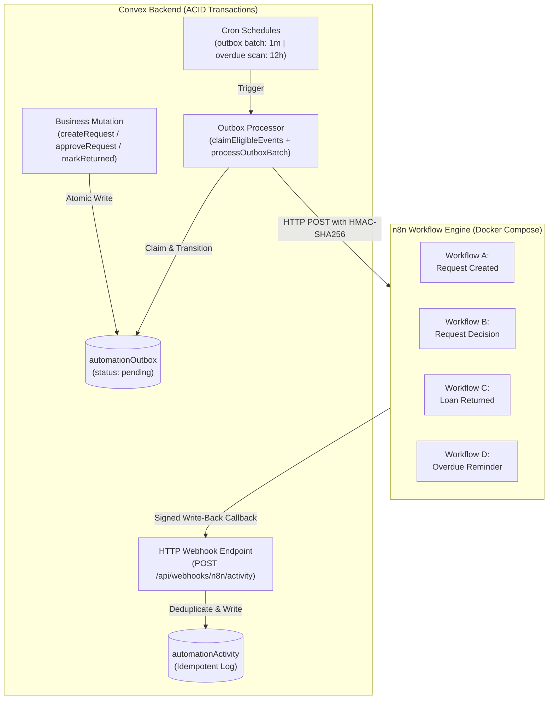

# LendLoop — Phase 7: n8n Automation and Webhook Integration

This document provides a comprehensive technical overview and operational guide for the LendLoop automation and webhook integration architecture.

---

## 1. Architecture Overview

LendLoop implements a robust, reliable event-driven automation layer using the **Transactional Outbox Pattern** alongside **n8n workflow orchestration** and **HMAC-SHA256 authenticated webhooks**.



### Key Architectural Tenets
1. **Zero Dual-Write Risk**: Platform events are never dispatched directly to external HTTP webhooks inside user-facing mutations. Events are atomically inserted into the `automationOutbox` table within the exact same database transaction as the business state transition.
2. **Guaranteed Delivery (At-Least-Once)**: A resilient polling processor claims pending events, manages retries with exponential backoff, and tracks delivery status.
3. **Strict Idempotency**: All outcomes written back by n8n to `automationActivity` utilize deterministic idempotency keys (`idempotencyKey`). Duplicate deliveries never generate duplicate logs or duplicate user notifications.
4. **End-to-End Cryptographic Security**: Webhook transmissions and write-back callbacks are authenticated with HMAC-SHA256 signatures and timestamp freshness enforcement (5-minute tolerance) to defend against spoofing and replay attacks.

---

## 2. Transactional Outbox Processing Engine

### Event State Lifecycle
Each record in `automationOutbox` advances through deterministic states:

```
[ pending ] ──(claimEligibleEvents)──> [ processing ]
    ▲                                        │
    │ (exponential backoff retry)            ├─(HTTP 200)──> [ sent ]
    └───────── (HTTP failure, attempts < 5) ─┤
                                             └─(attempts >= 5)──> [ failed ]
```

- **`pending`**: Event is queued for delivery. `nextRetryAt` determines eligibility.
- **`processing`**: Event is claimed by an active batch runner.
- **`sent`**: Successfully delivered to n8n (HTTP 2xx received) or verified in local simulation.
- **`failed`**: Terminal state reached when maximum retries (`MAX_RETRY_ATTEMPTS = 5`) are exhausted.

### Stale Processing Recovery
If an outbox processor crashes or a network request hangs indefinitely while an event is in `processing`, the event becomes eligible for recovery after **5 minutes** (`STALE_PROCESSING_TIMEOUT_MS = 5 * 60 * 1000`). Subsequent runs of `claimEligibleEvents` automatically reclaim stale events without administrative intervention.

### Exponential Backoff Policy
When an external webhook delivery fails:
1. `attempts` count is incremented.
2. If `attempts < 5`, status returns to `pending`.
3. `nextRetryAt` is delayed exponentially:
   $$\text{backoffDelay} = \min(2000 \times 2^{\text{attempts} - 1}, 3600000)\text{ ms}$$
   - Attempt 1: +2 seconds
   - Attempt 2: +4 seconds
   - Attempt 3: +8 seconds
   - Attempt 4: +16 seconds
   - Attempt 5: Transition to `failed` (dead-letter) with `lastError` logged.

---

## 3. Webhook Security Specification (HMAC-SHA256)

All communications between LendLoop and n8n are cryptographically verified using Web Crypto APIs.

### Request Headers
| Header | Description | Example |
| :--- | :--- | :--- |
| `Content-Type` | Payload content type | `application/json` |
| `X-LendLoop-Signature` | Hex-encoded HMAC-SHA256 signature | `sha256=e3b0c44298fc1c149afbf4c8...` |
| `X-LendLoop-Timestamp` | Unix timestamp in milliseconds | `1730995200000` |
| `X-LendLoop-Event` | Event type identifier | `borrow_request.created` |

### Signature Algorithm
1. The signing payload is formatted as `${timestamp}.${rawBody}`.
2. An HMAC-SHA256 digest is generated using the shared secret `N8N_WEBHOOK_HMAC_SECRET`.
3. The signature is compared in constant time (`timingSafeEqualHex`) to eliminate timing side-channel attacks.
4. The timestamp is validated against the server clock:
   $$|\text{serverTime} - \text{timestamp}| \le 300000\text{ ms (5 minutes)}$$
   Requests older than 5 minutes or dated in the distant future are rejected with HTTP 401.

---

## 4. Supported Event Types & Schemas

| Event Type | Triggering Mutation | Payload Description |
| :--- | :--- | :--- |
| `borrow_request.created` | `api.borrowRequests.createRequest` | Emitted when a neighbor requests a tool. Contains tool details, borrower profile, lender profile, and dates. |
| `borrow_request.approved` | `api.borrowRequests.approveRequest` | Emitted when a tool owner approves a request. |
| `borrow_request.declined` | `api.borrowRequests.declineRequest` | Emitted when a tool owner declines a request. |
| `loan.created` | `api.borrowRequests.approveRequest` | Emitted atomically alongside request approval when the active loan is initialized. |
| `loan.returned` | `api.loans.markReturned` | Emitted when a loan is marked returned. |
| `loan.overdue` | `internal.outbox.scanOverdueLoansAndRemind` | Emitted by the scheduled scan for active loans past their due date. |

---

## 5. Idempotent Automation Activity Logging

When n8n completes an automated task (such as sending an email or push notification), it posts an outcome back to LendLoop's HTTP endpoint:
`POST /api/webhooks/n8n/activity`

### Deterministic Idempotency Key Scheme
- Request Created: `notif:req_created:<requestId>`
- Request Decision: `notif:req_approved:<requestId>` or `notif:req_declined:<requestId>`
- Loan Returned: `notif:loan_returned:<loanId>`
- Overdue Reminder: `overdue:<loanId>:<YYYY-MM-DD>` (strictly one reminder per loan per calendar day)

If a callback is re-delivered due to network retries, the backend detects the duplicate key in `automationActivity` via index `by_idempotency_key` and returns `{ success: true, duplicate: true }` without inserting a second record.

---

## 6. n8n Workflows Reference

The workflow configurations are stored in `n8n/workflows/`:

1. **Workflow A: Request Notification (`workflow_a_request_created.json`)**
   - Webhook trigger on `borrow_request.created`.
   - Verifies HMAC signature, extracts lender and tool details.
   - Formats lender notification email.
   - Posts outcome back to `/api/webhooks/n8n/activity`.

2. **Workflow B: Request Decision (`workflow_b_request_decision.json`)**
   - Webhook trigger on `borrow_request.approved` or `borrow_request.declined`.
   - Conditional branch:
     - **Approved**: Formats loan details and pickup guidelines to borrower.
     - **Declined**: Formats decline notification and suggests other catalog tools.
   - Posts outcome back to `/api/webhooks/n8n/activity`.

3. **Workflow C: Loan Return Notification (`workflow_c_loan_returned.json`)**
   - Webhook trigger on `loan.returned`.
   - Sends thank-you confirmation to borrower and completion notice to lender.
   - Posts outcome back to `/api/webhooks/n8n/activity`.

4. **Workflow D: Overdue Loan Reminder (`workflow_d_overdue_reminder.json`)**
   - Dual trigger: Scheduled daily cron (`0 8 * * *`) and webhook endpoint (`loan.overdue`).
   - Normalizes overdue tool details and dates.
   - Formats urgent return reminder to the borrower.
   - Posts outcome back with key `overdue:<loanId>:<today>`.

---

## 7. Local Development & Docker Compose Setup

### Starting n8n Locally
To run the local n8n instance:
```bash
docker compose up -d
```

- **n8n Web UI**: [http://localhost:5678](http://localhost:5678)
- **Data Persistence**: Backed by Docker volume `n8n_data`.

### Environment Configuration (`.env.local`)
```env
# Convex Backend
NEXT_PUBLIC_CONVEX_URL=https://<your-deployment>.convex.cloud
CONVEX_SITE_URL=https://<your-deployment>.convex.site

# n8n Automation Engine
N8N_WEBHOOK_URL=http://localhost:5678/webhook/lendloop-events
N8N_WEBHOOK_HMAC_SECRET=your_32_byte_secret_key_here
```

---

## 8. Admin Console Monitoring

Administrators can monitor the live health of all platform automations from the **Admin Control Console**:
- **Delivered Events**: Total count of outbox events successfully dispatched.
- **Pending Outbox**: Events queued awaiting next batch cycle.
- **Failed Outbox**: Events requiring administrative attention.
- **Automation Activity Stream**: Real-time table of recent webhook outcomes with status badges, idempotency keys, and timestamps.
